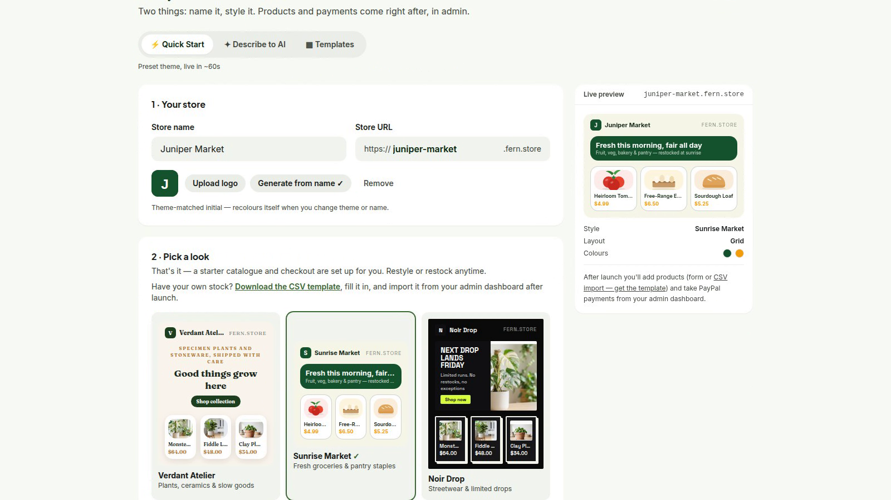
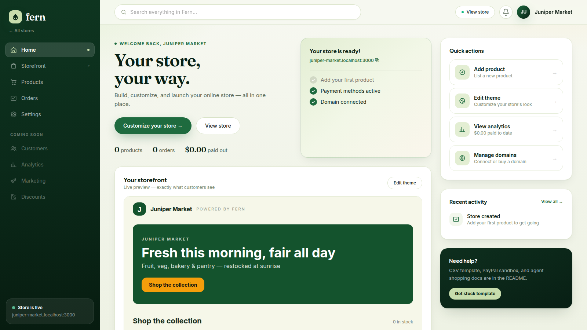
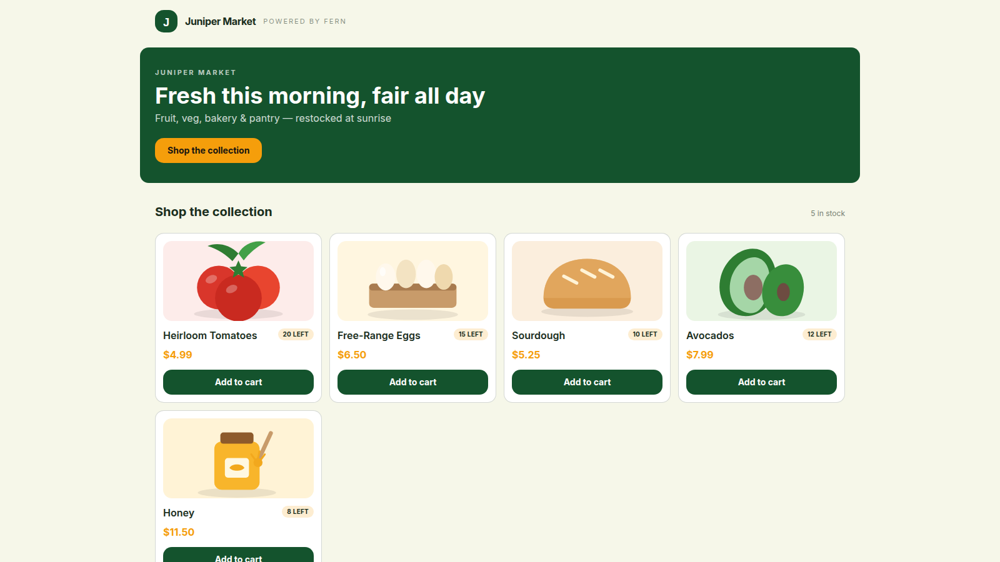
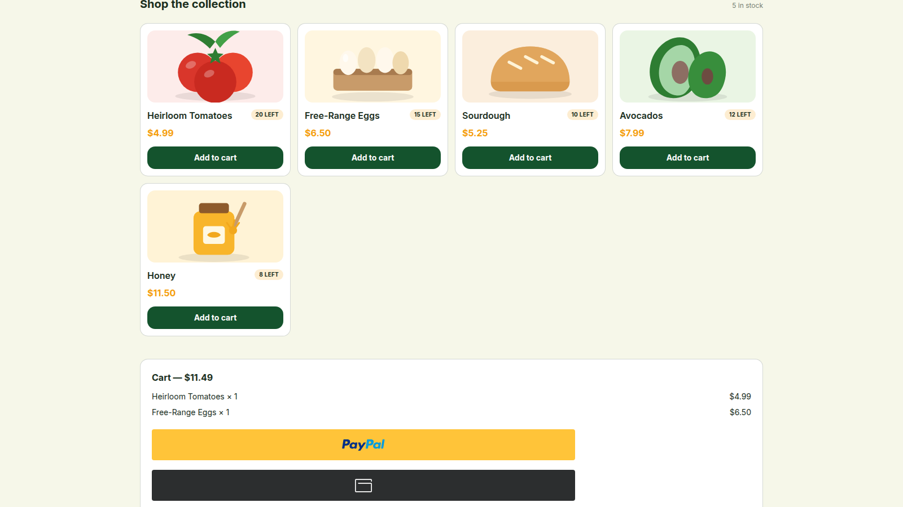
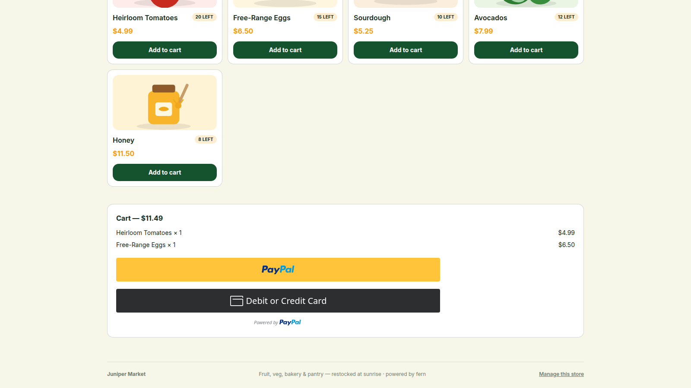

# fern at the PayPal AI Hackathon

## Title

fern: agent-ready storefronts in 18 seconds, with PayPal checkout humans and AI agents share

## Tagline

Name it, style it, sell it. Every fern store is shoppable by people with PayPal buttons and by AI agents through MCP and WebMCP, on the same PayPal Orders API v2 checkout.

## Inspiration

The web is getting a new customer, and it is not human. Bots made up 53% of web traffic in 2025, and Cloudflare measured them at roughly 57% of pages served by mid 2026. Agentic traffic grew 78-fold in a year. Yet only 2.3% of agent visits ever reach a checkout. Agents can browse our stores, but most stores cannot sell to them.

At the same time, shoppers are handing work to agents. Nearly half of online shoppers used AI while researching their last purchase, three in ten used ChatGPT, and almost two thirds expect to use AI shopping agents within two years. Worldpay expects 17% of purchases to run through agents within five years.

Small businesses cannot spend weeks rebuilding for that shift. We wanted the smallest possible answer: what if launching an agent-ready store felt as easy as naming one? That question became fern, and the demo opens with a real, uncut store build.

## What it does

fern is a zero-code, multi-tenant storefront builder. A seller opens the quickstart flow, names the store, watches the URL fill itself in, generates a logo from the name, picks a look, and launches. Our recorded run reached a live admin dashboard in 12.1 seconds of wall time, comfortably inside the 18 second promise in the film. The store opens at `<slug>.fern.store` or `/s/<slug>`, with products added by form or CSV import and PayPal checkout ready on day one.

Every fern store is also agent-buyable, with no separate integration:

- **Remote MCP server** at `POST /api/mcp` exposes `get_store`, `list_products`, `search_products`, `create_order`, and `pay_order`. An agent can search a catalogue, create a stock-checked order, send the buyer to PayPal approval, then capture payment.
- **WebMCP browser tools** register `search_products`, `add_to_cart`, and `checkout_cart` on the storefront itself as a progressive enhancement for browser agents.
- **One checkout, two kinds of buyer.** Humans use PayPal buttons or debit and credit card. Agents use the same Orders API v2 create and capture endpoints. Every paid order lands in the seller dashboard with status, total, items, and time.

The seller dashboard covers products, orders, settlement, domains, theme editing, CSV import, and a per-store Zapier webhook that posts `order.paid`.

## How we built it

- **App:** Next.js App Router, React, TypeScript, custom Tailwind styling.
- **Data:** Supabase Postgres and Storage, with open-demo RLS policies and a public `store-assets` bucket.
- **Payments:** PayPal Orders API v2 for create and capture, PayPal JS SDK buttons for humans, sandbox verified. Agent checkout reuses the same order lifecycle and database records.
- **Agent surfaces:** `mcp-handler` for the remote MCP server, plus `document.modelContext` for WebMCP storefront tools.
- **AI theme generation:** DeepSeek `deepseek-chat` in JSON mode, constrained to a palette and template schema, with a keyword mock fallback so the app still runs offline.
- **Dashboard:** AG Grid for product and order tables.
- **Automation:** per-store webhook URL posts `order.paid` JSON to Zapier catch hooks, connecting the store to the rest of a seller's tools.
- **Deploy path:** Docker on Render as a fallback, plus EC2 or GCE with Caddy wildcard TLS and host-based tenant routing for production subdomains.
- **Demo film:** HyperFrames for the 2:04 timeline. Playwright with Chromium recorded the real store creation and checkout UI. Kokoro generated the voiceover locally, and Deepgram `nova-2` supplied word timings so every scene beat and caption lands on the spoken line.

The proof in the demo is real: the Juniper Market store was created through the live quickstart UI, five products were seeded through the products API, and the MCP `search_products` and `create_order` calls produced a real PayPal sandbox order, `6VE16242LK089041M`, for $11.49 with `dummy:false`.

## Challenges we ran into

- **Agentic commerce is still being standardized.** There is no single checkout contract every agent speaks. We kept the surface small and mapped each MCP tool to a primitive a store already understands: browse, search, create order, pay.
- **One order lifecycle for two kinds of buyer.** Agent orders cannot be a second-class path. We reused the same PayPal order and `orders` table so seller reporting, stock checks, and webhooks work identically.
- **PayPal SDK latency.** The JS SDK can take 7 to 14 seconds to paint buttons in this environment. We extended waits and kept the recorded UI real instead of faking a faster checkout. A sandbox card capture also hit PayPal's generic "Something went wrong" error, so the film shows the verified cart and payment buttons rather than an invented receipt.
- **Stale totals in the PayPal button.** The button closure captured an old cart total after items changed. We fixed the effect dependency so the PayPal amount rerenders with the cart. That bug is exactly the kind of thing an agent checkout would expose at scale.
- **Multi-tenant routing.** Wildcard subdomains and path routing need to behave the same. Next.js middleware parses the host, resolves the store, and rewrites to `/s/<slug>`, with `/s/<slug>` as the reliable fallback.
- **Keeping the film honest.** The first cut recreated the wizard in HTML. We replaced it with a real Playwright screen recording, then trimmed only the head and tail. The timer overlay freezes at 18.0 seconds, and the recording reaches admin before that beat.

## Accomplishments that we are proud of

- A real store went from an empty form to a live admin dashboard in 12.1 seconds of wall time, under the 18 second claim in the video.
- A real PayPal sandbox order was created by an agent through MCP: `6VE16242LK089041M`, $11.49, `dummy:false`.
- One store serves humans and agents through the same PayPal checkout, with no plugin and no separate agent integration.
- The demo video is 2:04, under the three minute limit, built from real recordings, and passes the HyperFrames check with zero errors.
- The app still works end to end without PayPal keys through simulated checkout, so judges can click through without a sandbox account.

## What we learned

- Agent readiness is a product surface, not a protocol checkbox. Tool names, descriptions, stock checks, and error states matter as much as the payment call.
- Agents and humans should share the same checkout primitives. A separate agent-only API creates two sources of truth for orders and inventory.
- PayPal approval is still the trust anchor. Buyers want a familiar place to approve payment, even when an agent initiated the purchase.
- Latency is part of the experience. Agent flows need resumability, idempotency, and clear states when a payment provider is slow or a buyer abandons approval.
- Recording real UI makes a demo more convincing and more useful. It also exposes real bugs, like the stale cart total, that a mock would hide.
- Small businesses need fewer settings, not more protocols. The default path should be agent-ready without a configuration screen.

## What's next for Fern

- Ship a public hosted demo with custom domains and wildcard TLS for every store.
- Turn on direct seller settlement with `paypal_merchant_id` and the `payee` field, so money settles straight into the seller's PayPal account, with platform fees on the same order.
- Add richer agent tooling: idempotency keys, order status lookup, refunds, and compatibility with the PayPal Agent Toolkit and emerging agent checkout standards.
- Add human versus agent analytics, so sellers can see where agent traffic drops before checkout and fix it.
- Expand payments beyond PayPal balance and card, and add inventory sync and webhook retries for production sellers.
- Improve store creation with more templates, better CSV mapping, and bulk product editing.

## Built with

PayPal Orders API v2, PayPal JS SDK, MCP, WebMCP, Next.js, React, TypeScript, Supabase, Postgres, AG Grid, Zapier, Render, Docker, Caddy, DeepSeek, HyperFrames, Playwright, Kokoro, Deepgram, ffmpeg.

## Links

- **GitHub:** https://github.com/ThatLinuxGuyYouKnow/fern
- **Run locally:** `npm install`, copy `.env.example` to `.env.local`, `npm run dev`, then open `http://localhost:3000/create?mode=quickstart`.
- **Agent MCP endpoint:** `POST /api/mcp`

## Screenshots

Real UI from the sandbox run, captured at 1600x900.

**Create a store, live**

**Store is live**

**Storefront**

**Cart with PayPal and card checkout**

**Debit or credit card form**

